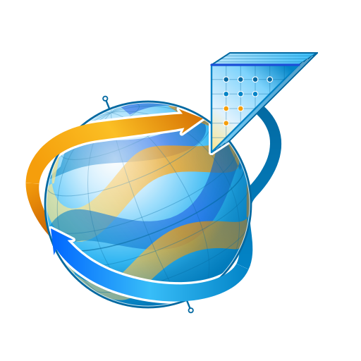
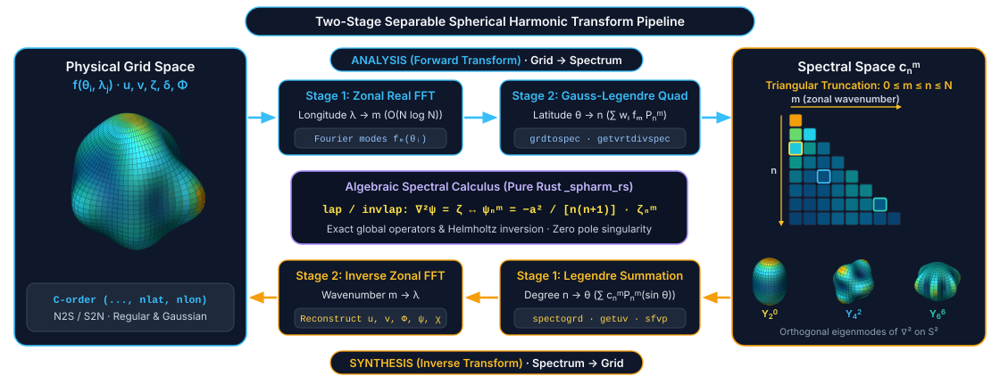
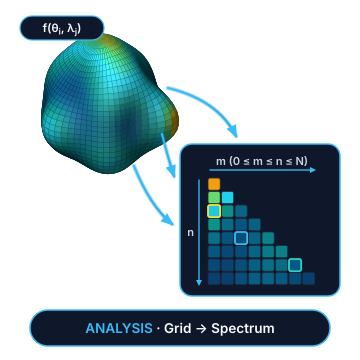
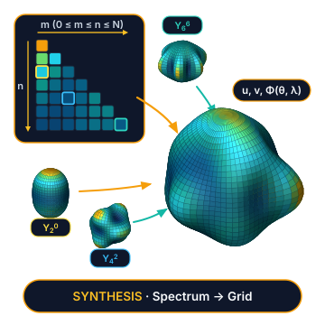

<p align="center">
  <a href="https://github.com/skyborn-org/Skyborn" target="_blank">
    
  </a>
</p>

[](https://badge.fury.io/py/skyborn)
[](https://pypi.org/project/skyborn/)
[](https://pypi.org/project/skyborn/)
[](https://codecov.io/gh/skyborn-org/Skyborn)
[](https://github.com/skyborn-org/Skyborn/blob/main/LICENSE)
[](https://github.com/skyborn-org/Skyborn/actions/workflows/stable-ci.yml)
[](https://github.com/skyborn-org/Skyborn)
[](https://github.com/psf/black)
[](https://github.com/skyborn-org/Skyborn/actions/workflows/test-coverage.yml?query=branch%3Amain)
[](https://skyborn.readthedocs.io/en/latest/)
[](https://doi.org/10.5281/zenodo.18075252)

## System Requirements

- **Operating Systems:** **Linux**, **macOS (Apple Silicon & Intel)**, and **Windows** (full cross-platform support with self-contained native wheels)
- **Python Versions:** **Python 3.9–3.14** (NumPy 1.24–2.x)

## Installation

To install the Skyborn package, you can use pip:

```bash
pip install skyborn
```
or

```bash
pip install -U --index-url https://pypi.org/simple/ skyborn
```

## 📚 Documentation

**Full documentation is available at: [Documentation ](https://skyborn.readthedocs.io/en/latest/)**


## 🎯 Key Features & Submodules

### 📊 Spatial Trend Analysis & Climate Index Regression

Skyborn provides ultra-fast spatial trend calculation and climate index regression analysis for atmospheric data:


**Key Capabilities:**
- **High-Speed Spatial Trends**: Calculate long-term climate trends across global grids
  - Linear trend analysis for temperature, precipitation, and other variables
  - Statistical significance testing
  - Vectorized operations for massive datasets
- **Mann-Kendall Trend Analysis**: Robust non-parametric trend testing for both
  single time series and multidimensional climate fields
  - Supports multiple Mann-Kendall test families including original,
    Yue-Wang, Hamed-Rao, seasonal, correlated seasonal, grouped multivariate,
    regional, correlated multivariate, and partial Mann-Kendall workflows
  - Direct multidimensional support for arrays such as ``(time, lat, lon)``,
    ``(time, level, lat, lon)``, and xarray-based labeled data
  - Batch-oriented compiled kernels make gridded workloads much faster than
    looping over one series at a time in pure Python

- **Climate Index Regression**: Rapid correlation and regression analysis with climate indices
  - NINO 3.4, PDO, NAO, AMO index integration
  - Pattern correlation analysis
  - Teleconnection mapping

**Other Applications:**
- Climate change signal detection
- Decadal variability analysis
- Teleconnection pattern identification
- Regional climate impact assessment

Skyborn extends Mann-Kendall analysis from one-dimensional time series to
multidimensional NumPy and xarray workflows, making it suitable for large
gridded climate-analysis tasks as well as standard single-series trend tests.

### 🌍 Skyborn Spharm & Windspharm: Spherical Harmonics Primer, Analysis & Synthesis

<table>
  <tr>
    <td width="156" align="center" valign="middle">
      
    </td>
    <td valign="middle">
      <strong>Pure-Rust Spherical Harmonic Engine (<code>_spharm_rs</code> v0.2.0)</strong><br/>
      <code>skyborn.spharm</code> and <code>skyborn.windspharm</code> are powered by <code>skyborn-spharm</code>, a Pure-Rust spherical harmonic transform backend with zero Fortran/OpenBLAS runtime dependencies, native <code>float32</code>/<code>float64</code> precision, and zero-copy C-order <code>S2N</code>/<code>N2S</code> dispatch across regular, Gaussian, and ECMWF reduced Gaussian grids.
    </td>
  </tr>
</table>

#### Waves on a Sphere: A Popular-Science Primer

<p align="center"></p>

Just as a 1D Fourier series decomposes a signal around a circle into pure sine and cosine waves, **spherical harmonics** $Y_n^m(\theta,\lambda) = \bar{P}_n^m(\sin\theta)e^{im\lambda}$ decompose global geophysical fields (such as wind, vorticity, geopotential, and temperature) into smooth, orthogonal 2D wave patterns over the entire sphere:

- **Zonal modes ($m = 0$)**: Symmetric latitude belts with no variation in longitude, capturing the pole-to-equator mean state and zonal jet bands.
- **Tesseral modes ($0 < m < n$)**: Checkerboard wave cells across midlatitudes, capturing planetary Rossby waves and storm tracks.
- **Sectorial modes ($m = n$)**: Orange-slice wave sectors peaking along the equator, capturing tropical wave trains and Walker-scale oscillations.

Because $Y_n^m(\theta,\lambda)$ are smooth global eigenfunctions of the spherical Laplacian, spectral transforms completely eliminate the latitude-longitude **"pole problem"** caused by converging meridians and polar finite-difference singularities (Swarztrauber 1979, 1993, 1996; Adams & Swarztrauber 1999; Swarztrauber & Spotz 2000).

#### From Grid to Spectrum and Back: Analysis, Spectral Calculus & Synthesis

<p align="center"></p>

<table>
  <tr>
    <td width="50%" align="center" valign="top">
      <br/>
      <strong>Analysis (Forward Transform, Grid &rarr; Spectrum)</strong><br/>
      <code>Zonal Real FFT</code> along longitude (&lambda; &rarr; <i>m</i>) followed by <code>Gauss-Legendre Quadrature</code> along latitude (&theta; &rarr; <i>n</i>) via <code>grdtospec</code> and <code>getvrtdivspec</code>, projecting physical grids into triangularly truncated spectral coefficients <i>c<sub>n</sub><sup>m</sup></i> (0 &le; <i>m</i> &le; <i>n</i> &le; <i>N</i>).
    </td>
    <td width="50%" align="center" valign="top">
      <br/>
      <strong>Synthesis (Inverse Transform, Spectrum &rarr; Grid)</strong><br/>
      <code>Legendre Summation</code> across degree <i>n</i> followed by <code>Inverse Zonal FFT</code> (<i>m</i> &rarr; &lambda;) via <code>spectogrd</code>, <code>getuv</code>, <code>sfvp</code>, and <code>helmholtz</code>, reconstructing smooth scalar fields or rotational and divergent wind components cleanly.
    </td>
  </tr>
</table>

- **Spectral Calculus (Exact Algebraic Operators)**: In spectral space, horizontal differentiation and Poisson inversion reduce to exact diagonal arithmetic: $\nabla^2 \leftrightarrow -n(n+1)/a^2$ and $\nabla^{-2} \leftrightarrow -a^2/[n(n+1)]$ (`lap` / `invlap`). Streamfunction $\psi$ and velocity potential $\chi$ are inverted directly from vorticity $\zeta$ and divergence $\delta$ with zero polar coordinate singularities.

#### Quick Start (`VectorWind`, `SpharmTransform` & `ReducedVectorWind`)

```python
import numpy as np
from skyborn.spharm import SpharmTransform
from skyborn.windspharm import ReducedVectorWind, VectorWind

# 1. Modern 4D C-order ERA5/CMIP6 winds: (time, level, lat, lon), south-to-north
nlat, nlon = 181, 360
lats_s2n = np.linspace(-90.0, 90.0, nlat)
u = np.random.randn(12, 8, nlat, nlon).astype(np.float32)
v = np.random.randn(12, 8, nlat, nlon).astype(np.float32)

# Automatic C-order zero-copy layout detection + S2N support + float32 precision
vw = VectorWind(u, v, gridtype="regular", lat=lats_s2n, precision="auto")
vrt, div = vw.vrtdiv()                   # (12, 8, 181, 360), float32, S2N preserved
psi, chi = vw.sfvp()                     # streamfunction & velocity potential
psi_poisson = vw.invlap(vrt)             # grid-space Poisson inversion (nabla^-2 vrt)
u_chi, v_chi, u_psi, v_psi = vw.helmholtz()

# 2. Direct scalar Analysis <-> Synthesis in native float64 precision
sht = SpharmTransform(
    nlon=nlon, nlat=nlat, gridtype="regular", lat=lats_s2n, precision="double"
)
spec = sht.grdtospec(u.astype(np.float64))  # (12, 8, nmdim)
inv_spec = sht.invlap(spec)                 # spectral inverse Laplacian (-a^2 / [n(n+1)])
u_rec = sht.spectogrd(spec)                 # ~1e-13 round-trip accuracy

# 3. Packed ECMWF reduced Gaussian wind analysis
pl = np.array([20, 28, 36, 40, 40, 36, 28, 20], dtype=np.int32)
u_red = np.random.randn(4, int(pl.sum()))
v_red = np.random.randn(4, int(pl.sum()))
rvw = ReducedVectorWind(u_red, v_red, pl=pl, precision="double")
psi_red, chi_red = rvw.sfvp()
```


**Key Capabilities & Applications:**
- **Rotational & Divergent Decomposition**: Compute vorticity, divergence, streamfunction ($\psi$), velocity potential ($\chi$), Rossby wave sources, and full Helmholtz wind decomposition across global regular, Gaussian, and packed reduced Gaussian grids.
- **Climate Dynamics & Weather Diagnostics**: Ideal for jet stream diagnostics, tropical monsoon convergence/divergence analysis, planetary wave propagation, and multi-dimensional CMIP6/ERA5 batch processing.

### 🔧 Skyborn Gridfill Submodule - Data Interpolation

The Skyborn `gridfill` submodule provides advanced interpolation techniques for filling missing data in atmospheric and climate datasets:


**Key Features:**
- **Poisson-based Interpolation**: Physically consistent gap filling
- **Preserves Data Patterns**: Maintains spatial correlations and gradients
- **Multiple Methods Available**:
  - Basic Poisson solver
  - High-precision iterative refinement
  - Zonal initialization options
  - Relaxation parameter tuning

**Applications:**
- Satellite data gap filling
- Model output post-processing
- Climate data reanalysis
- Quality control for observational datasets

The example above demonstrates filling gaps in global precipitation data, where the algorithm successfully reconstructs missing values while preserving the underlying meteorological patterns.

### Curly Vector Plotting

Skyborn provides an NCL-like `curly_vector` renderer for atmospheric wind fields while keeping a Matplotlib and Cartopy compatible API.


**Key Capabilities:**
- **NCL-like Curved Vectors**: Curved tails and lighter arrow heads for cleaner large-scale flow visualization
- **Matplotlib-Compatible API**: Works with standard axes and Cartopy projections without switching to a separate plotting stack
- **Flexible Inputs**: Supports regular lat-lon grids, xarray datasets, and curvilinear grids such as WRF mass-grid wind fields
- **Vertical Cross-Section Support**: Supports latitude-pressure and similar vertical profile plots through the same `curly_vector` API
- **Projection-Aware Rendering**: Supports global rendering with different `central_longitude` settings and Cartopy projections

Skyborn `curly_vector` also supports vertical cross-section rendering, for example latitude-pressure plots using meridional wind and scaled omega:


**Minimal Example:**
```python
import cartopy.crs as ccrs
import matplotlib.pyplot as plt
from skyborn.plot import curly_vector

fig = plt.figure(figsize=(12, 6))
ax = plt.axes(projection=ccrs.Robinson(central_longitude=180))

curly_vector(
    ds,
    x="longitude",
    y="latitude",
    u="u",
    v="v",
    ax=ax,
    transform=ccrs.PlateCarree(),
    density=0.9,
    color="black",
    arrowstyle="->",
    linewidth=1.2,
    arrowsize=1.2,
    zorder=3,
    integration_direction='both',
    ref_magnitude=30.0,
    ref_length=0.1,
)
ax.coastlines()
ax.set_global()
```

## Performance Benchmarks

### 🚀 Spharm & Windspharm Performance (Pure-Rust `_spharm_rs` v0.2.0)

Powered by the Pure-Rust [`skyborn-spharm`](https://github.com/skyborn-org/skyborn-spharm) (`_spharm_rs` v0.2.0) engine using `faer` SIMD matrix kernels, `realfft`/`rustfft`, and adaptive `rayon` multithreading, Skyborn replaces legacy Fortran SPHEREPACK 3.2 (`_spherepack`) with **up to 9.64x end-to-end speedups on global grids (287.2x on high-degree `legendre`)**, **up to 7.58x lower working memory**, and **machine-precision `float64` transforms** with zero `libgfortran` dependency.

#### End-to-End Speed & Spectral Round-Trip Error Across Grids

*(Warmed median wall time on Apple Silicon `arm64`, Python 3.14, `--release` build with `S2N` C-order `float32` batches; Fortran E2E includes the required `S2N -> N2S` flip and `(lat, lon, batch)` transpose/copy.)*

| Grid / Operator | Batch | Rust `_spharm_rs` | Fortran E2E | Speedup | Round-Trip Max Error (`R32` / `F32` / `R64`) |
| :--- | :--- | :--- | :--- | :--- | :--- |
| `2.5°` Regular (`73×144`, `T72`) `grdtospec` / `getvrtdivspec` | `nt=64` | `2.05 / 1.83 ms` | `3.73 / 7.33 ms` | **1.82x / 4.00x** | `5.36e-7` / `9.56e-7` / **`2.40e-14`** |
| `1.0°` Regular (`181×360`, `T180`) `grdtospec` / `getvrtdivspec` | `nt=64` | `5.15 / 13.64 ms` | `49.59 / 104.69 ms` | **9.63x / 7.68x** | `1.45e-6` / `2.78e-6` / **`1.77e-13`** |
| `0.5°` Regular (`361×720`, `T360`) `grdtospec` / `getvrtdivspec` | `nt=32` | `20.71 / 32.69 ms` | `189.88 / 314.95 ms` | **9.17x / 9.64x** | `1.97e-6` / `8.11e-6` / **`2.05e-13`** |
| `F160` Gaussian (`160×320`, `T159`) `grdtospec` / `spectogrd` | `nt=96` | `5.49 / 5.50 ms` | `21.55 / 25.24 ms` | **3.92x / 4.59x** | – |
| `F480` Gaussian (`960×1920`, `T959`) `grdtospec` / `getvrtdivspec` | `nt=8` | `50.22 / 227.03 ms` | Overflow (`ierror=4`) | **Rust only** | – |
| `O80` Reduced Gaussian (`27,200` pts) `grdtospec` / `spectogrd` | `nt=32` | `2.30 / 1.79 ms` | `14.47 / 4.67 ms` | **6.31x / 2.61x** | – |
| `regrid` (`73×144` &rarr; `160×320`) | `nt=96` | `4.53 ms` | `31.95 ms` | **7.06x** | – |
| `legendre(35.5°, T319)` / `specintrp(T319)` | `nt=1` | `0.123 / 0.033 ms` | `35.173 / 0.081 ms` | **287.2x / 2.44x** | `f64` overflow-free ($n \ge 149$ safe) |
| `lap` / `invlap` (`T63` / `T319`) | `nt=1` | `0.0005 / 0.0071 ms` | `0.0006 / 0.0119 ms` | **1.15x–1.68x** | `0.00e+0` (`f32` exact) |

#### Peak Working Memory Savings (`ru_maxrss` Delta Above Input Arrays)

By streaming large batches through bounded tiles (`MAX_TILE_SIZE = 32`, `MAX_SCRATCH_BYTES = 64 MB`) and reading `S2N` C-order arrays zero-copy, peak working memory drops substantially across resolutions and batch sizes:

| Scaling Case | Operator | Input Volume | Rust Peak Overhead | Fortran E2E Peak Overhead | RAM Saved |
| :--- | :--- | :--- | :--- | :--- | :--- |
| **Grid Scaling**: `2.5°` (`73×144`, `nt=64`) | `grdtospec` / `getvrtdivspec` | `2.6 / 5.1 MB` | `+6.5 / +14.8 MB` | `+11.8 / +23.2 MB` | **5.3 / 8.4 MB** (`1.82x / 1.57x`) |
| **Grid Scaling**: `1.0°` (`181×360`, `nt=64`) | `grdtospec` / `getvrtdivspec` | `15.9 / 31.8 MB` | `+33.7 / +77.3 MB` | `+80.9 / +144.3 MB` | **47.2 / 67.0 MB** (`2.40x / 1.87x`) |
| **Grid Scaling**: `0.5°` (`361×720`, `nt=64`) | `grdtospec` / `getvrtdivspec` | `63.5 / 126.9 MB` | `+148.6 / +258.0 MB` | `+457.4 / +709.6 MB` | **308.9 / 451.6 MB** (`3.08x / 2.75x`) |
| **Grid Scaling**: `0.25°` (`721×1440`, `nt=32`) | `grdtospec` / `getvrtdivspec` | `126.7 / 253.5 MB` | `+779.5 / +1535.1 MB` | `+2504.0 / +3003.3 MB` | **1,724.4 / 1,468.2 MB** (`3.21x / 1.96x`) |
| **Batch Scaling**: `1.0°` (`181×360`, `nt=128`) | `grdtospec` / `getvrtdivspec` | `31.8 / 63.6 MB` | `+33.9 / +85.0 MB` | `+64.2 / +207.8 MB` | **30.3 / 122.8 MB** (`1.89x / 2.44x`) |
| **Batch Scaling**: `1.0°` (`181×360`, `nt=512`) | `grdtospec` / `getvrtdivspec` / `getpsichi` | `127.3 / 254.5 / 254.5 MB` | `+33.7 / +134.1 / +388.7 MB` | `+255.6 / +829.8 / +1340.4 MB` | **221.9 / 695.7 / 951.7 MB** (`7.58x / 6.19x / 3.45x`) |

> **Note on Legacy Comparison Plot:** The historical chart below shows the earlier Fortran-based `windspharm` vs. reference baseline prior to the Pure-Rust `_spharm_rs` v0.2.0 migration, which now delivers the multi-fold speedups and memory reductions documented above.


### ⚡ GPI Module Performance

The Genesis Potential Index (GPI) module achieves **dramatic speedups** through vectorized Fortran implementation and native 3D processing:


**Performance Highlights:**
- **About 25x faster** than point-by-point implementations
- Processes entire atmospheric grids in seconds
- Native multi-dimensional support (3D/4D data)


**Accuracy Validation:**
- Correlation is effectively 1.0 against the reference implementation
- RMSE is now on the order of **1e-4** for the core PI outputs, with very small overall error
- Log-decomposition diagnostics also remain tightly matched to the updated `tcpyPI` results


## 📖 Citation

If you use Skyborn in your research, please cite it using the following format:

```bibtex
@software{su2025skyborn,
  author = {Su, Qianye},
  title = {Skyborn: Climate Data Analysis Toolkit},
  year = {2025},
  doi = {10.5281/zenodo.18075252},
  url = {https://doi.org/10.5281/zenodo.18075252}
}
```

Or in text:
> Su, Q. (2025). Skyborn: Climate Data Analysis Toolkit. Zenodo. https://doi.org/10.5281/zenodo.18075252
